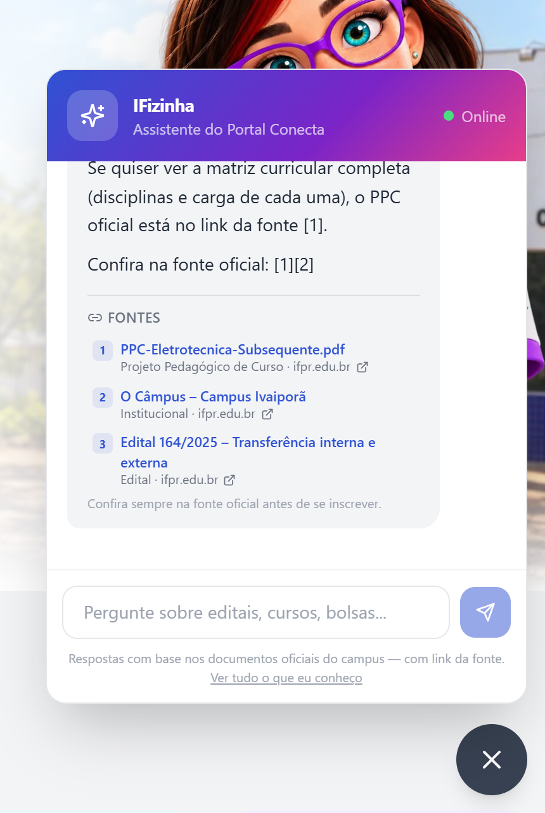
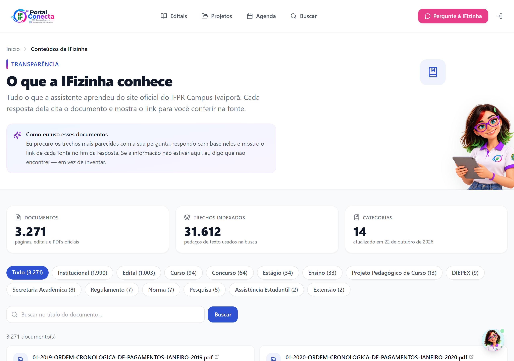

?# Corpus do site do IFPR no RAG da IFizinha

**O que este documento cobre:** como os arquivos markdown extraídos de
`ifpr.edu.br/ivaipora` entram na base de conhecimento do portal, como a IFizinha
cita a fonte de cada resposta e como consultar o índice do que ela conhece.





---

## 1. O que foi importado

Fonte: pasta `data/markdown` do repositório **ExtratorIFPR** (3.323 arquivos,
42 MB), que é o site do Campus Ivaiporã convertido para markdown — páginas HTML
e PDFs (editais, PPCs, portarias, regulamentos).

| Situação | Arquivos |
|---|---|
| Importados como documento da base | **3.271** |
| Ignorados (sem conteúdo útil: só navegação/links) | 52 |
| Com erro | 0 |
| Trechos (chunks) gerados | **31.612** |

Distribuição por categoria (a pasta do extrator vira a categoria do chunk):

| Categoria | Documentos |
|---|---|
| institucional | 1.990 |
| edital | 1.003 |
| curso | 94 |
| concurso | 64 |
| estagio | 34 |
| ensino | 33 |
| ppc | 13 |
| diepex | 9 |
| regulamento | 7 |
| norma | 7 |
| secretaria | 8 |
| pesquisa | 5 |
| assistencia | 2 |
| extens | 2 |

Cada documento vira uma linha em `documentos_kb` e N linhas em `chunks_kb`
(~700 tokens por trecho, com sobreposição de 100). O `metadata` guarda
`url_fonte`, `url_documento_original`, `pagina_de_origem`, `data_publicacao`,
`ultima_atualizacao`, `categoria` e `caminho_arquivo`.

---

## 2. Como importar

```bash
# 1. Schema e infraestrutura de busca (uma vez por banco)
#    NÃO use `prisma db push` (ver LEIAME): o banco tem objetos que o schema não
#    declara (Edital.projetoId, índice HNSW) e o push os apagaria.
psql "$DATABASE_URL" -f prisma/rag-tabelas-setup.sql      # cria documentos_kb/chunks_kb
psql "$DATABASE_URL" -f prisma/pgvector-setup.sql         # requer a extensão vector
psql "$DATABASE_URL" -f prisma/busca-textual-setup.sql    # não requer extensão

# 2. Importação do corpus
npm run rag:importar
```

Por padrão a pasta lida é `../ExtratorIFPR/data/markdown` (relativa ao projeto).
Para apontar outro diretório:

```bash
MARKDOWN_DIR=/caminho/para/markdown npm run rag:importar
# ou
npx ts-node --project tsconfig.scripts.json -r tsconfig-paths/register \
  prisma/importar-markdown-ifpr.ts --dir=/caminho/para/markdown
```

### Opções

| Flag | Variável de ambiente | Efeito |
|---|---|---|
| `--limite=N` | `RAG_LIMITE=N` | processa só os N primeiros arquivos (teste) |
| `--categorias=edital,curso` | `RAG_CATEGORIAS=...` | importa só essas pastas |
| `--dry-run` | `RAG_DRY_RUN=1` | lê e conta, não grava nada |
| `--forcar` | `RAG_FORCAR=1` | reindexa mesmo sem mudança (ex.: gerar embeddings) |
| `--sem-embeddings` | `RAG_SEM_EMBEDDINGS=1` | grava texto sem vetor |
| `--apenas-indice` | `RAG_APENAS_INDICE=1` | regera só o documento de índice |
| `--verboso` | `RAG_VERBOSO=1` | loga arquivo por arquivo |

> As variáveis de ambiente existem porque o npm 11 no Windows engole flags
> depois de `--` em alguns casos ("Unknown cli config --limite"). Elas funcionam
> sempre.

### Idempotência

Rodar de novo não duplica nada: cada documento é identificado por
`ref_id = ifpr-md:<id-do-extrator>` e por um hash do conteúdo **+ URL de
origem**. Sem mudança, o arquivo é pulado (segunda execução medida: 6,7 s para
3.271 documentos). Com mudança, o documento ganha `versao + 1` e os chunks
antigos são apagados antes de recriar.

### Embeddings (busca semântica)

`GEMINI_API_KEY` liga a geração de vetores (1536 dimensões, `gemini-embedding-2`,
tier gratuito). **Sem a chave a importação continua funcionando**, mas grava os
trechos sem vetor e avisa no final. Nesse modo quem responde é a busca textual
(seção 4).

Ao configurar a chave depois, basta reindexar:

```bash
npm run rag:importar -- --forcar
```

---

## 3. Fontes em toda resposta

Toda resposta da IFizinha vem acompanhada da lista de fontes, com link para a
página oficial — o mesmo padrão de "IA com citações".

- O contexto enviado ao modelo numera **tudo** no mesmo formato: `[fonte 1]`,
  `[fonte 2]`... (documento, projeto e edital). Isso é proposital: quando o
  projeto usava `[projeto 1]`, o modelo citava só documento e a página do
  projeto não aparecia na lista.
- O modelo é instruído a citar o número no fim da frase (`... até 10 de março [1].`)
  e a citar **cada item** quando lista projetos/editais.
- A lista final mostra **apenas as fontes citadas** e **apenas as que têm link**
  (`filtrarFontesCitadas`): fonte sem link não deixa ninguém conferir a origem.
- O servidor monta a lista a partir dos trechos que a busca **realmente**
  devolveu (`src/lib/fontes-resposta.ts`) e a envia junto da resposta:

```json
{
  "reply": "...",
  "fontes": [
    {
      "numero": 1,
      "titulo": "Edital 86/2018 – Homologação das Inscrições",
      "url": "https://ifpr.edu.br/ivaipora/wp-content/uploads/sites/15/2018/07/Edital-08-2018-homologacao.pdf",
      "categoria": "Edital",
      "tipo": "documento",
      "trecho": "…",
      "data": "2018-07-04"
    }
  ]
}
```

O `ChatWidget` (`src/components/chat/ChatWidget.tsx`) renderiza esses itens logo
abaixo da resposta, com o número, o título, a categoria e o domínio do link.

**Ponto importante:** a lista aparece mesmo que o modelo esqueça de citar no
texto. Instrução de prompt é sugestão; lista montada por código é garantia.

Projetos e editais cadastrados no portal também entram como fonte, apontando
para `/projetos/<slug>` e `/editais/<slug>`.

### Perguntas sobre uma pessoa

"Quais projetos o prof. Ronan está envolvido?" é pergunta sobre **uma pessoa**,
não sobre projetos em geral. `src/lib/pessoa-na-pergunta.ts` compara a pergunta
com a lista real de coordenadores do banco e, quando reconhece alguém, a consulta
passa a filtrar por `coordenador`/`viceCoordenadorNome` **sem o corte de 10** e o
contexto informa o total.

Isso corrigiu um bug real (22/10/2026): a lista do prof. Ronan vinha com 5 dos 6
projetos e sem o do "TV Box", porque a consulta pegava os 10 projetos do topo do
portal e só 1 era dele. O que faltava aparecia apenas quando a pessoa citava o
nome do projeto na pergunta.

---

## 4. Busca: vetorial com rede de segurança textual

`src/lib/busca-vetorial.ts` tenta, nesta ordem:

1. `match_chunks_kb` (RPC do pgvector — similaridade de cosseno);
2. consulta direta com o operador `<=>`;
3. **busca textual** em português (`to_tsvector` + `normalizar_busca`).

A terceira etapa existe para dois cenários reais: ambiente sem a extensão
`vector` (Windows de desenvolvimento) e chunks importados sem `GEMINI_API_KEY`.
Antes ela devolvia 50 trechos aleatórios com `similarity: 0.5` fixo — o chat
respondia com o documento errado sem nenhum sintoma. Hoje ela:

- ignora acento (`transferencia` encontra `transferência`);
- monta a consulta em funil (E de todos os termos → E dos 2 mais específicos → OU);
- reordena os candidatos por IDF (termo raro pesa mais que termo comum) e por
  cobertura do título;
- devolve lista vazia se nada casar — melhor a IFizinha dizer "não encontrei"
  do que citar o documento errado.

Trazer a busca textual para produção também **melhora** o resultado em perguntas
com termos exatos (número de edital, nome de curso), que embedding costuma
diluir.

---

## 5. Índice do que a IFizinha conhece

- Página pública: **`/ifizinha/conteudos`** (link no rodapé e no widget do chat).
  Mostra totais, categorias, busca por título e a lista paginada de documentos
  com link para a fonte de cada um.
- Documento de índice na base: `ref_id = ifpr-md:indice`, título
  _"Índice de conteúdos que a IFizinha conhece"_. É gerado automaticamente ao
  fim de cada importação e responde perguntas do tipo "o que você sabe?".
- Implementação: `src/lib/indice-conteudos.ts` + `src/app/ifizinha/conteudos/page.tsx`.

---

## 6. Aplicar na VPS (produção)

O banco de produção é o PostgreSQL local da VPS (ver
`deploy/MIGRACAO_SUPABASE_PARA_VPS.md`), com pgvector 0.8.6. O que foi feito em
22/10/2026, na ordem:

```bash
# 0. backup antes de qualquer escrita
sudo -u postgres pg_dump -Fc portal_conecta > /root/portal_conecta-antes-rag-$(date +%Y%m%d-%H%M).dump
tar czf /root/portal-conecta-codigo-antes-rag-$(date +%Y%m%d-%H%M).tgz -C /var/www portal-conecta

# 1. infraestrutura (idempotente; NÃO use `prisma db push` — ver LEIAME)
cd /var/www/portal-conecta
sudo -u postgres psql -d portal_conecta -f prisma/rag-tabelas-setup.sql
sudo -u postgres psql -d portal_conecta -f prisma/busca-textual-setup.sql

# 2. corpus (42 MB) enviado da máquina local
mkdir -p /var/www/corpus-ifpr && tar xzf corpus-ifpr.tgz -C /var/www/corpus-ifpr

# 3. importação sem vetores (rápida: ~40 s para 3.323 arquivos)
MARKDOWN_DIR=/var/www/corpus-ifpr RAG_SEM_EMBEDDINGS=1 npm run rag:importar

# 4. vetores em job separado, retomável (ver seção 8)
RAG_LOTE=100 RAG_RPM=95 nohup npm run rag:embedar > /root/rag-embeddings.log 2>&1 &

# 5. índice vetorial HNSW (depois de os vetores existirem)
sudo -u postgres psql -d portal_conecta -f prisma/pgvector-setup.sql
```

> **Deploy do código:** o caminho normal é push na `main` (GitHub Actions,
> blue-green). Neste trabalho o deploy foi feito pelo mesmo script, à mão:
> `tar` do repositório → `/var/www/portal-conecta-novo` → `bash deploy/deploy-vps.sh deploy`.
> Ele copia `.env` e `.suap-token.json` da árvore no ar, roda `npm ci`, builda,
> troca as pastas e volta sozinho se o site não responder.

Depois de subir o app, testar no chat: *"Qual a carga horária do curso de
Eletrotécnica?"* — a resposta deve citar o PPC e mostrar o link do PDF do PPC.

> **Atenção (divergência repositório × produção):** conforme o LEIAME, o código
> em produção não é um checkout git. Antes de levar estas mudanças para a VPS,
> reconcilie os arquivos alterados (`src/lib/busca-vetorial.ts`,
> `src/lib/fontes-resposta.ts`, `src/lib/embeddings.ts`,
> `src/app/api/chat/route.ts`, `src/components/chat/ChatWidget.tsx`,
> `src/lib/indice-conteudos.ts`, `src/app/ifizinha/conteudos/page.tsx`,
> `prisma/importar-markdown-ifpr.ts`, `prisma/embedar-chunks-pendentes.ts` e os
> `.sql`) em vez de sobrescrever o servidor com o repositório inteiro.

---

## 7. Limite do Gemini (por que os vetores não entram de uma vez)

Medido em 22/10/2026 com `GEMINI_API_KEY` do tier gratuito:

| Métrica | Limite | Efeito |
|---|---|---|
| `EmbedContentRequestsPerMinute…FreeTier` | 100/min | o job precisa se conter |
| `EmbedContentRequestsPerDay…FreeTier` | **1.000/dia** | o corpus inteiro (31,4 mil trechos) levaria ~31 dias |

Cada TRECHO conta como uma requisição. Por isso a importação foi feita em duas
fases: texto primeiro (segundos) e vetores por um job retomável
(`npm run rag:embedar`), que respeita 100/min e para quando estoura a cota
diária — retomando de onde parou no dia seguinte (`embedding IS NULL`).

Para indexar tudo de uma vez é preciso **ativar o faturamento** no projeto do
Google AI Studio (Tier 1). O custo estimado do corpus inteiro é de **centavos**
(~2,5 milhões de tokens × US$ 0,15/1M ≈ US$ 0,40). Com isso:

```bash
RAG_LOTE=100 RAG_RPM=800 nohup npm run rag:embedar > /root/rag-embeddings.log 2>&1 &
```

Enquanto nem todos os trechos têm vetor, **o chat continua bom**: a busca é
híbrida (textual + vetorial, fundidas por RRF), então o que falta de vetor é
coberto pelo casamento de termos.

---

## 8. Diagnóstico rápido

| Sintoma | Causa provável | Correção |
|---|---|---|
| `type "vector" does not exist` | pgvector não instalado | `psql -f prisma/pgvector-setup.sql` (ou use só a busca textual) |
| Respostas genéricas, sem citar documento | base vazia | `npm run rag:importar` |
| Chat responde mas não acha nada | chunks sem embedding e busca textual sem índice | `psql -f prisma/busca-textual-setup.sql` |
| `function normalizar_busca does not exist` | busca textual não aplicada | `psql -f prisma/busca-textual-setup.sql` |
| "A busca inteligente está em modo simplificado" no /admin/rag | `GEMINI_API_KEY` ausente | configurar e `npm run rag:importar -- --forcar` |
| Documento antigo aparece na resposta | importação com link corrigido e hash antigo | `npm run rag:importar` (a URL entra no hash) |

Relatório da última importação:
`storage/relatorios/importacao-rag-ifpr.json` (fora do Git).

